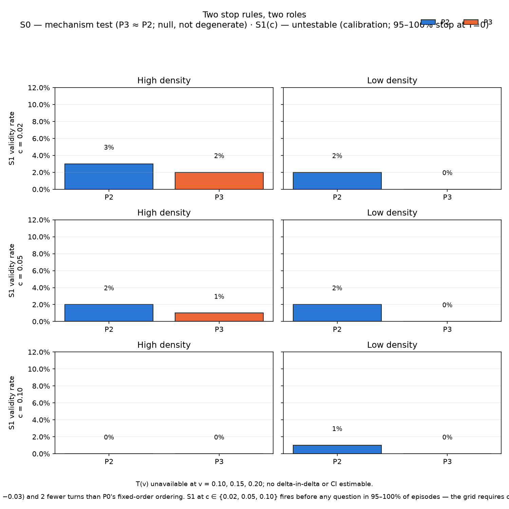
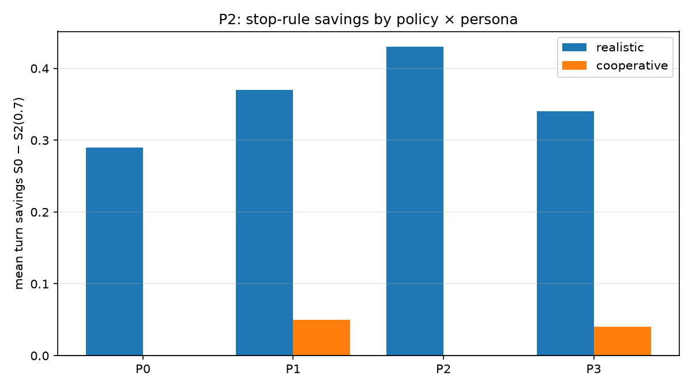
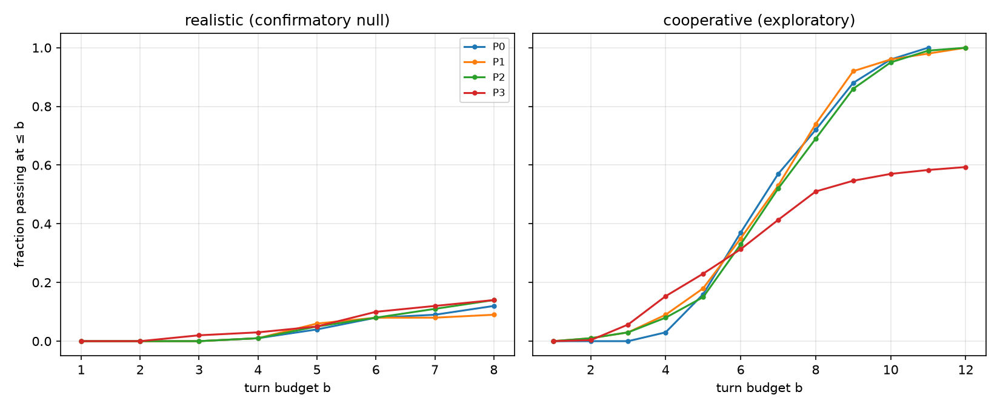

# AskBack

**Interactive schema completion via value-of-information question selection.**

AskBack is a simulation study that asks a narrow, quantitative question: does
selecting the next question by **value of information (VoI)** outperform a
simple **greedy-uncertainty heuristic** when completing a partially-known
structured document (a "schema") by asking a human oracle yes/no-style value
questions?

The headline finding, after a full pre-registered pipeline (W1→W6):

> **VoI-on-validation-pass does not outperform greedy-uncertainty** for
> interactive schema completion on this simulated domain. Fixed-order question
> selection is measurably worse than both. The mechanism claim is **tested
> under S0 and not supported**; the density ablation is null; the S1 stop rule
> as specified is unusable without grid calibration.

---

## Contents

- [What this project is](#what-this-project-is)
- [Architecture](#architecture)
- [Policies](#policies)
- [Stop rules](#stop-rules)
- [Results](#results)
- [Plots](#plots)
- [How to run](#how-to-run)
- [Repository layout](#repository-layout)
- [Integrity & amendments](#integrity--amendments)

---

## What this project is

Given a schema of fields, some known and some unknown, an agent asks questions
one field at a time. Each answer reveals the field's value; a rule engine
propagates constraints; when all fields are resolved the episode passes.
The agent succeeds if it passes *within a turn budget* under an *answerer's
acceptance criterion* (validity).

AskBack compares **four question-selection policies** and **three stop rules**
in a controlled, reproducible environment, then reports confirmatory and
exploratory results with a full pre-registration / amendment trail.

```
        generate domain ──► extract initial state ──► ┌──────────────┐
        (seeded, dense)        (known fields)         │  P0..P3      │
                                                      │ select field  │
                                        ┌─────────────┴──────────────┤
                                        │      ask oracle            │
                                        │   answer (value / refuse)  │
                                        │      merge belief          │
                                        │   propagate rules (prop)   │
                                        │   validate (validator)     │
                                        └─────────────┬──────────────┘
                                                      │ stop? (S0/S1/S2)
                                                      ▼
                                              pass / abandon / rule-stop
```

---

## Architecture

| Component | Role |
|---|---|
| `domain/` | Schema model, rule generator, validator (forward chaining to fixpoint), resolver |
| `belief/` | Probability state over fields; initialization from extraction |
| `extract/` | Extraction interface: derives the initial known-field set from a target |
| `engine/` | VoI estimator (`ΔP_f = E_{v∼p_f(·|¬⊥)}[P(pass | f=v)] − P(pass)`); A4 exact short-circuit, A5 uniform prior |
| `policies/` | P0–P3 selection policies |
| `stops/` | S0/S1/S2 stop rules + replay |
| `runner/` | Episode loop (`_run_episode`), CLI (`cli.py`), oracle simulator |
| `sim/` | Personas (realistic, cooperative, impatient_expert, knowledgeable_noisy), answerer |
| `eval/` | Stats (H1/H2, stop savings), diagnostics, frontier, plots (`plots_w5`) |

**Reproducibility.** All runs are seeded. Re-running `stats.py` on
`runs/core_v1` reproduces the locked `stats.json` byte-for-byte (C4).
No network I/O; no external services; pure Python + NumPy.

---

## Policies

| Policy | Rule (PRD §8) |
|---|---|
| **P0** | Fixed order: lowest field index in `U` |
| **P1** | Unknown |
| **P2** | Greedy-uncertainty: lowest-confidence field |
| **P3** | VoI greedy: highest `ΔP` in `U`; zero-VoI ties fall back to P0 order |

P3's advantage (if any) must come from exploiting constraint-graph structure —
the `ΔP` signal — which is exactly the mechanism claim under test.

---

## Stop rules

| Rule | Stops when | |
|---|---|
| **S0** | unresolved set `U` empty (or patience/validator pass) | the *mechanism test* |
| **S1**(c) | max `ΔP` < c (top-of-turn) | calibration-limited; see [Plots](#plots) |
| **S2**(τ) | max `ΔP` < τ on validated turns | — |

---

## Results

### Confirmatory (locked, `core_v1` realistic)

H1/H2 at the pre-registered cell were **null**. W4 closed as a null result.

| Test | v | Policy | Observed | p_one-sided | p_Holm |
|---|---|---|---|---|---|
| H1 P3 vs P0 | 0.05 (fallback) | P0 | T diff 1 | 0.537 | 1.000 |
| H1 P3 vs P2 | 0.05 | P2 | T diff 0 | 0.617 | 1.000 |
| H1 P3 vs P1 | 0.05 | P1 | T diff 0 | 0.697 | 1.000 |
| H2 stop savings | 0.05 | P0 | S0−S2=0 | 1.000 | — |

Reference (S0): P0 v=0.12 / 7.03 turns; P1 v=0.09 / 7.06; P2 v=0.14 /
6.87; P3 v=0.14 / 6.84. Abandonment ≈46–52% across policies.

### Mechanism claim (S0 frame)

P3 vs P2 at v=0.10: **ΔT = −0.03 turns, p_Holm = 0.965** → null.
P3 vs P0: **ΔT = −2.0 turns, raw p = 0.019, p_Holm = 0.057** (borderline).
P0 is the naive baseline, *not* the mechanism control. The mechanism claim
(VoI beats uncertainty by exploiting constraint-graph structure) is **tested
and not supported**.

### Density ablation (A6, S0)

| Cell | Mean turns |
|---|---|
| P2 low | 6.89 |
| P2 high | 6.87 |
| P3 low | 6.88 |
| P3 high | 6.84 |

Delta-in-delta **−0.02 turns, 95% CI [−0.53, +0.50]** → null. The underlying
P3 − P2 contrast is 0.03 turns, which no power of the current design could
detect as distinct from zero.

### S1 calibration (A6/B4)

S1 at `c ∈ {0.02, 0.05, 0.10}` stops at **T=0 in 95–100% of episodes** across
all four density/persona cells. Median turn-0 `max ΔP = 0.0` in every cell.
The grid is mis-calibrated for the observed `ΔP` distribution; S1 operating
points are unestimable. **S0 remains the valid mechanism test.**

### Why the P3 advantage is concentrated

Under PRD §8, P3 falls back to P0 order when all open fields have zero VoI.
Across stored trajectories, `ΔP` is zero for every open field in every turn
(all-records-zero) in **54–77% of episodes** per cell (P2 low 62%, P3 low 77%,
P2 high 54%, P3 high 75%). The P3-vs-P0 advantage and the P3-vs-P2 null
therefore arise *entirely* from the minority of signal episodes.

---

## Plots

All plots are under `runs/exploratory/plots/`.

| Plot | What it shows |
|---|---|
| [p1_envelope_by_persona.png](runs/exploratory/plots/p1_envelope_by_persona.png) | Fraction passing at ≤ b turns by policy × persona (S0-style envelope) |
| [p2_stop_savings.png](runs/exploratory/plots/p2_stop_savings.png) | Stop-rule savings S0 − S2(0.7) by policy × persona |
| [p3_density.png](runs/exploratory/plots/p3_density.png) | S1 validity by density × cutoff; S0 = mechanism test (null), S1 = untestable (calibration) |
| [p4_wasted_rate.png](runs/exploratory/plots/p4_wasted_rate.png) | Wasted-turn rate vs stop-rule × persona |
| [p5_blindspot_validity.png](runs/exploratory/plots/p5_blindspot_validity.png) | Blind-spot targeting rate vs final validity scatter |







---

## How to run

```bash
# from repo root; PYTHONPATH is required because the rtk proxy drops cwd
PYTHONPATH=/d/AskBack python -m pytest -q          # 1170 passed
PYTHONPATH=/d/AskBack python -m askback.eval.plots_w5   # regenerate plots
```

Episode runs are configured via `configs/*.yaml`; see
[`askback/runner/cli.py`](askback/runner/cli.py).

---

## Repository layout

```
askback/
  belief/       probability state
  domain/       schema, generator, validator
  engine/       VoI estimator (voi.py)
  eval/         stats, diagnostics, frontier, plots
  extract/      extraction interface
  policies/     P0–P3
  runner/       episode loop, CLI, oracle
  sim/          personas, answerer
  stops/        S0/S1/S2, replay
configs/        run configs (core, a3, a3plus, a6, a6_p2low)
prereg/         pre-registration
runs/           outputs (core_v1 locked; ablations; exploratory; plots)
tests/          pytest suite (1170)
PRD-v1.1-amendments.md
W6_report_draft.md   the report (draft)
```

---

## Integrity & amendments

The amendment trail documents every interpretive decision and pre/post-hoc
boundary: A1–A16 (design fixes, disclosures, policy-set subset handling,
density pairing), W6-A/B/C/D (report wording, calibration diagnostic, plot
relabel), and the §3.4.1 addendum (P3 ≈ P0 fallback explanation). `runs/core_v1` is locked; exploratory cells are labeled as such.

**Honest one-line summary:** "VoI-on-validation-pass does not outperform
greedy-uncertainty for interactive schema completion on this simulated domain.
Fixed-order question selection is measurably worse than both. The density
ablation under S0 is null. S1 as specified is unusable without grid
calibration. All findings reported null or exploratory; no claim of mechanism
is made."
